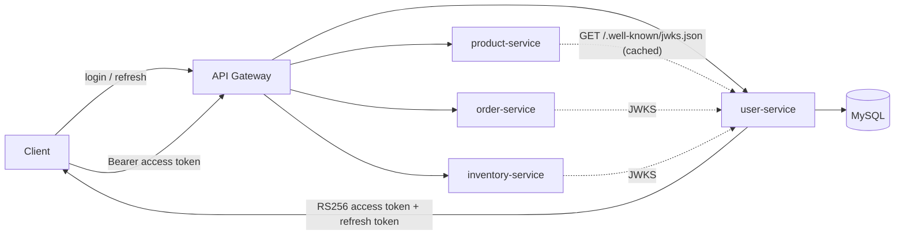

# user-service

Authentication and user-management service for **ShopSphere**.
It registers users, signs them in, issues short-lived **RS256 access tokens** plus rotating **refresh tokens**,
and publishes the public keys (JWKS) that every other service uses to verify those tokens.

**Stack:** Java 17 · Spring Boot 3.5 · Spring Security · Spring Data JPA · MySQL 8 + Flyway · Eureka client · Micrometer/Prometheus

---

## Contents

1. [Features](#features)
2. [How it fits into the platform](#how-it-fits-into-the-platform)
3. [Quick start](#quick-start)
4. [API reference](#api-reference)
5. [Token contract (for other services)](#token-contract-for-other-services)
6. [Configuration](#configuration)
7. [Signing keys and rotation](#signing-keys-and-rotation)
8. [Security design](#security-design)
9. [Database](#database)
10. [Observability and operations](#observability-and-operations)
11. [Testing](#testing)
12. [Project structure](#project-structure)
13. [Troubleshooting](#troubleshooting)
14. [Not included](#not-included)

---

## Features

- **Accounts:** registration, login, profile update, change password, "sign out everywhere".
- **Tokens:** RS256 access tokens (15 min) with `kid`, `iss`, `aud`, `jti`; opaque single-use refresh tokens (7 days) that rotate on every use and detect replay.
- **JWKS endpoint** (`/.well-known/jwks.json`) with zero-downtime key rotation.
- **Password reset and e-mail verification** with single-use hashed tokens and resend cooldown; no account enumeration.
- **Brute-force protection:** per-account lockout (atomic in SQL, works across replicas) and per-IP rate limiting.
- **Admin tools:** list/search users, enable/disable, change role, unlock. Guard rails: no self-disable, no self-demotion, the last active admin cannot be disabled or demoted.
- **Audit trail** in the database (`audit_events`) plus an `AUDIT` log stream.
- **Operations:** Prometheus metrics, request ids, readiness/liveness probes, graceful shutdown, housekeeping job.

## How it fits into the platform



Only user-service holds the **private** key. Every other service verifies tokens with the **public** keys from the JWKS and therefore cannot mint tokens.

---

## Quick start

### Run everything locally with Docker

```bash
docker compose up --build
```

This starts MySQL and the service on **http://localhost:8081**. For local development the compose file generates a throw-away signing key (`JWT_ALLOW_EPHEMERAL_KEY=true`), writes e-mails to the container log (`MAIL_LOG_ONLY=true`) and creates a first admin `admin@example.com` / `change-me-local-admin-1`.

### Try it

```bash
# 1. register
curl -s -X POST localhost:8081/api/auth/register -H 'Content-Type: application/json' \
  -d '{"name":"Asha","email":"asha@example.com","password":"Str0ng-Passw0rd!"}'

# 2. login
curl -s -X POST localhost:8081/api/auth/login -H 'Content-Type: application/json' \
  -d '{"email":"asha@example.com","password":"Str0ng-Passw0rd!"}'
# -> {"accessToken":"eyJ...","refreshToken":"...","tokenType":"Bearer","expiresIn":900}

# 3. call a protected endpoint
curl -s localhost:8081/api/user/me -H "Authorization: Bearer <accessToken>"

# 4. look at the public keys other services use
curl -s localhost:8081/.well-known/jwks.json
```

Because `MAIL_LOG_ONLY=true`, verification and reset links appear in `docker compose logs user-service`.

### Run from source

Requirements: JDK 17+, Maven 3.9+, a MySQL 8 database.

```bash
export DB_URL=jdbc:mysql://localhost:3306/shopsphere_user_db
export DB_USERNAME=shopsphere
export DB_PASSWORD=...
export EUREKA_ENABLED=false
export EUREKA_DEFAULT_ZONE=http://localhost:8761/eureka/
export APP_VERIFY_URL='http://localhost:3000/verify-email?token={token}'
export APP_RESET_URL='http://localhost:3000/reset-password?token={token}'
export JWT_ALLOW_EPHEMERAL_KEY=true      # development only
export MAIL_LOG_ONLY=true                # development only
mvn spring-boot:run
```

Flyway creates the schema on first start. On Windows use Git Bash (`export` syntax above).

---

## API reference

Base URL: `http://localhost:8081`. All bodies are JSON. Errors are RFC 9457 `application/problem+json`:

```json
{ "type": "about:blank", "title": "Bad Request", "status": 400,
  "detail": "Validation failed", "errors": { "email": "Invalid email" } }
```

Every response carries an `X-Request-Id` header (a well-formed client-supplied id is echoed, otherwise one is generated).

### Authentication (public)

| Method | Path | Body | Result |
|---|---|---|---|
| POST | `/api/auth/register` | `{name, email, password}` | `201` user. `400` invalid or weak password, `409` e-mail taken |
| POST | `/api/auth/login` | `{email, password}` | `200 {accessToken, refreshToken, tokenType, expiresIn}`. `401` for **any** credential problem (wrong password, unknown user, locked, disabled). `403` if the e-mail is unverified (only after a correct password, and only when `EMAIL_VERIFICATION_REQUIRED=true`) |
| POST | `/api/auth/refresh` | `{refreshToken}` | `200` new token pair (old refresh token is now dead). `401` if invalid, expired or replayed |
| POST | `/api/auth/logout` | `{refreshToken}` | `204`, idempotent. Ends that session |
| POST | `/api/auth/forgot-password` | `{email}` | always `202`. Mails a reset link if the account exists (max one per minute) |
| POST | `/api/auth/reset-password` | `{token, newPassword}` | `204`. Revokes all sessions and clears any lockout. `400` invalid token or weak password |
| POST | `/api/auth/verify-email` | `{token}` | `204`. `400` invalid or used token |
| POST | `/api/auth/resend-verification` | `{email}` | always `202` |
| GET | `/.well-known/jwks.json` | | public keys (`Cache-Control: public, max-age=300`) |

### Current user (role USER or ADMIN)

| Method | Path | Body | Result |
|---|---|---|---|
| GET | `/api/user/me` | | profile |
| PATCH | `/api/user/me` | `{name}` | updated profile |
| POST | `/api/user/me/password` | `{currentPassword, newPassword}` | `204`. Revokes all sessions. Wrong current password counts toward lockout |
| DELETE | `/api/user/me/sessions` | | `204`. Signs out of every device |

### Administration (role ADMIN)

| Method | Path | Body | Result |
|---|---|---|---|
| GET | `/api/admin/users?page=&size=&email=` | | paged list (`size` ≤ 100, `email` = contains) |
| GET | `/api/admin/users/{id}` | | details incl. lock state |
| PUT | `/api/admin/users/{id}/enabled` | `{enabled}` | `204`. Disabling revokes the user's sessions |
| PUT | `/api/admin/users/{id}/role` | `{role}` (`USER` or `ADMIN`) | `204` |
| POST | `/api/admin/users/{id}/unlock` | | `204` |

### Operations

| Path | Access | Purpose |
|---|---|---|
| `/actuator/health/liveness`, `/actuator/health/readiness` | public | Kubernetes probes (readiness includes the database) |
| `/actuator/info`, `/actuator/prometheus` | loopback and private networks only | metrics. **Also block them at the gateway** |

### Validation rules

- Password: 8–72 bytes, not on the common-password list (`common-passwords.txt`), must not contain the e-mail name.
- E-mail: valid format, at most 254 characters, normalised (trimmed, lower-case) on register and login.
- Name: required, at most 100 characters. Request bodies larger than 16 KB are rejected with `413`.

---

## Token contract (for other services)

Access tokens are **RS256 JWTs**. A service must verify them with the keys from `GET /.well-known/jwks.json` (select the key by the `kid` header, cache for about 5 minutes, refetch when an unknown `kid` appears) and check:

| Item | Required value |
|---|---|
| header `alg` | `RS256`, reject everything else |
| `iss` | `JWT_ISSUER` (default `shopsphere-user-service`) |
| `aud` | contains `JWT_AUDIENCE` (default `shopsphere-api`) |
| `exp` | not expired (allow about 30–60 s clock skew) |
| `sub` | numeric user id |
| `role` | `USER` or `ADMIN` |

Spring Boot resource-server example (this is how product-service does it):

```java
NimbusJwtDecoder decoder = NimbusJwtDecoder.withJwkSetUri(jwksUri)
        .jwsAlgorithm(SignatureAlgorithm.RS256).build();
decoder.setJwtValidator(new DelegatingOAuth2TokenValidator<>(
        JwtValidators.createDefaultWithIssuer("shopsphere-user-service"),
        new JwtClaimValidator<List<String>>("aud", aud -> aud != null && aud.contains("shopsphere-api"))));
```

Map the `role` claim to `ROLE_USER` / `ROLE_ADMIN`.

**Revocation latency:** access tokens are not checked against the database. A role change or a disabled account takes effect when the 15-minute token expires or is refreshed. For instant revocation add a `jti` / user deny-list at the gateway.

---

## Configuration

All settings are environment variables (see `src/main/resources/application.yml`; `.env.example` lists them all).

### Required

| Variable | Description |
|---|---|
| `DB_URL`, `DB_USERNAME`, `DB_PASSWORD` | MySQL connection. No defaults on purpose |
| `JWT_PRIVATE_KEY` | RSA private key, PKCS#8 PEM or single-line Base64 DER (see [Signing keys](#signing-keys-and-rotation)) |
| `EUREKA_DEFAULT_ZONE` | Eureka server URL (set `EUREKA_ENABLED=false` to disable discovery) |
| `APP_VERIFY_URL`, `APP_RESET_URL` | Links put into e-mails; `{token}` is replaced. Point them at your frontend or gateway page |

### E-mail

SMTP is configured **only** through Spring's environment variables:

```
SPRING_MAIL_HOST=smtp.example.com
SPRING_MAIL_PORT=587
SPRING_MAIL_USERNAME=...
SPRING_MAIL_PASSWORD=...
SPRING_MAIL_PROPERTIES_MAIL_SMTP_AUTH=true
SPRING_MAIL_PROPERTIES_MAIL_SMTP_STARTTLS_ENABLE=true
MAIL_FROM=no-reply@example.com
```

Without SMTP no e-mail is sent (an error is logged and the request still succeeds). E-mails are sent asynchronously, so an SMTP outage never slows or fails a request, and the mail health check is disabled so it cannot take the service out of rotation.
`MAIL_LOG_ONLY=true` writes e-mails **including secret links** to the log. Development only.

### Optional

| Variable | Default | Description |
|---|---|---|
| `JWT_ISSUER` / `JWT_AUDIENCE` | `shopsphere-user-service` / `shopsphere-api` | must match what other services expect |
| `JWT_ACCESS_TTL` / `JWT_REFRESH_TTL` | `PT15M` / `P7D` | ISO-8601 durations |
| `JWT_PREVIOUS_PUBLIC_KEYS` | empty | comma-separated public keys, only while rotating |
| `EMAIL_VERIFICATION_REQUIRED` | `false` | set `true` once SMTP works |
| `LOCKOUT_MAX_ATTEMPTS` / `LOCKOUT_DURATION` | `5` / `PT15M` | account lockout |
| `RATE_LIMIT_ENABLED` / `RATE_LIMIT_AUTH_PER_MIN` | `true` / `20` | per IP and endpoint, per replica |
| `AUDIT_RETENTION_DAYS` | `365` | audit rows older than this are purged |
| `PURGE_CRON` | `0 30 3 * * *` | housekeeping schedule; `-` disables it on a replica |
| `ADMIN_EMAIL` / `ADMIN_PASSWORD` / `ADMIN_NAME` | empty | creates the first admin if it does not exist (password ≥ 12 chars). Remove after the first start |
| `DB_POOL_MAX` / `DB_POOL_MIN_IDLE` | `20` / `5` | Hikari pool |
| `SERVER_PORT` | `8081` | |
| `FORWARD_HEADERS_STRATEGY` | `none` | set `native` behind a trusted proxy so the rate limiter sees real client IPs |
| `TRACING_ENABLED` / `TRACING_SAMPLING_PROBABILITY` / `OTEL_EXPORTER_OTLP_ENDPOINT` | `false` / `0.1` / `http://localhost:4318/v1/traces` | OpenTelemetry |

### Local development only (never in production)

`JWT_ALLOW_EPHEMERAL_KEY=true` generates a throw-away key at startup (tokens die on restart and differ per replica). Without a key and without this flag the service refuses to start.

---

## Signing keys and rotation

Generate a key (needs `openssl`; Git Bash on Windows has it):

```bash
bash scripts/generate-jwt-key.sh
# JWT_PRIVATE_KEY=MIIEv...   <- store in your secret manager, never commit
# JWT_PUBLIC_KEY=MIIBI...    <- keep it for rotation
```

All replicas must use the same private key. The key id (`kid`) is derived from the public key, so replicas agree automatically and a retired key keeps the `kid` its old tokens carry. Keys must be RSA with at least 2048 bits (the script makes 3072); a malformed or weak key stops the service at startup.

**Rotate without downtime**

1. Generate a new key pair.
2. Deploy with `JWT_PRIVATE_KEY=<new private key>` and `JWT_PREVIOUS_PUBLIC_KEYS=<old public key>`. New tokens use the new key; tokens signed with the old key still verify, and both keys appear in the JWKS.
3. After the access-token lifetime plus the JWKS cache time (about 20 minutes), remove `JWT_PREVIOUS_PUBLIC_KEYS`.

---

## Security design

- **Passwords:** BCrypt (cost 12). Policy: length, common-password list, no e-mail name inside. The BCrypt 72-byte limit is enforced (not silently truncated).
- **Login responses:** wrong password, unknown user, locked and disabled accounts all return the same `401`, and unknown users are processed in comparable time.
- **Lockout:** 5 failed passwords lock the account for 15 minutes. Counters are atomic SQL updates (correct under concurrency and across replicas) and survive restarts. The owner gets an e-mail; admins can unlock; a password reset also clears the lock.
  Trade-off: anyone who knows an e-mail address can lock that account for 15 minutes. Mitigate with per-IP limits at the gateway/WAF.
- **Refresh tokens:** 256-bit random, stored only as SHA-256, single use, rotated on every use. Presenting an already-used token revokes the whole session and is audited (`auth_refresh_replay_total`). Password change/reset, disabling a user and "sign out everywhere" revoke all sessions.
- **Reset / verification tokens:** single use, hashed at rest, 30 min / 24 h, one e-mail per minute per account. A weak new password does not burn the reset link.
- **Rate limiting:** per IP and per endpoint on every unauthenticated route (fixed 1-minute window, in memory). It is per replica: also enforce a limit at the gateway.
- **Admin guard rails and audit:** every admin action is written to `audit_events` with the acting admin; no self-disable or self-demotion; the last active admin is protected.
- **Request hardening:** 16 KB body limit, strict validation, JSON errors without stack traces, `alg` pinned to RS256, audience and issuer checked.
- **Known trade-off:** registration answers `409` for an existing e-mail (usability over enumeration resistance).

---

## Database

Flyway migrations (`baseline-on-migrate=false`):

| Migration | Contents |
|---|---|
| V1 | `users` |
| V2 | not-null role/timestamps, `enabled`, `failed_attempts`, `locked_until` |
| V3 | `refresh_tokens` |
| V4 | `email_verified`, `password_changed_at` (existing users are marked verified) |
| V5 | `user_tokens` (verification / reset) |
| V6 | `audit_events` |

If a database already contains the `users` table but has no `flyway_schema_history`, start once with `SPRING_FLYWAY_BASELINE_ON_MIGRATE=true` and `SPRING_FLYWAY_BASELINE_VERSION=1`, then remove both. Take a backup before the first start of a new version. Give the application user only DML rights if migrations run under a separate account.

---

## Observability and operations

**Logs:** every line carries the `requestId`. Security events go to the `AUDIT` logger. Set `LOGGING_STRUCTURED_FORMAT_CONSOLE=ecs` for JSON logs.

**Metrics** (`/actuator/prometheus`):

| Metric | Meaning |
|---|---|
| `auth_login_total{outcome}` | `success`, `bad_credentials`, `rejected`, `unverified` |
| `auth_register_total` | registrations |
| `auth_refresh_total{outcome}` | `success`, `failure` |
| `auth_refresh_replay_total` | a used refresh token was presented again |
| `auth_lockout_total` | accounts locked |
| `auth_ratelimit_total{endpoint}` | requests rejected by the rate limiter |
| `auth_account_total{event}` | `password_changed`, `password_reset`, `email_verified`, `sessions_revoked` |

Plus JVM, HTTP server and Hikari pool metrics. Suggested alerts: a spike in `auth_login_total{outcome="bad_credentials"}`, any increase of `auth_refresh_replay_total`, rising `auth_lockout_total` or `auth_ratelimit_total`, readiness down, Hikari pending threads.

**Kubernetes:** liveness `/actuator/health/liveness`, readiness `/actuator/health/readiness`. Graceful shutdown is on (30 s), so set `terminationGracePeriodSeconds` ≥ 40.

**Housekeeping:** a scheduled job deletes expired refresh/verification/reset tokens and audit rows older than `AUDIT_RETENTION_DAYS`. It is idempotent; set `PURGE_CRON=-` on all but one replica to run it once.

**Concurrency note:** under heavy parallel use of the same refresh token, MySQL may report a deadlock for the losing requests; the service maps it to `409`. Clients should treat `401` or `409` on refresh as "sign in again".

---

## Testing

```bash
mvn verify
```

runs unit tests, MockMvc API tests on H2 with the real security chain, MySQL integration tests with Testcontainers, and the JaCoCo coverage gate (report in `target/site/jacoco/index.html`).

- The **MySQL tests need Docker** and are skipped automatically without it. They run the real Flyway migrations, boot with `ddl-auto=validate`, and exercise race conditions: concurrent registration of one e-mail, concurrent use of one refresh token, concurrent failed logins.
- Tests use the `test` and `h2` Spring profiles and an ephemeral key; nothing needs to be configured.

CI (`.github/workflows`) builds, tests and runs Trivy on dependencies and on the Docker image; Dependabot keeps Maven, Docker and GitHub Actions up to date.

---

## Project structure

```
src/main/java/com/shopsphere/userservice
├── config/        AppProperties, JwtProperties, SecurityConfig, AppConfig (UTC clock)
├── controller/    AuthController, UserController, AdminController, JwksController
├── dto/           request/response records
├── entity/        User, RefreshToken, UserToken, AuditEvent, enums
├── exception/     domain exceptions + GlobalExceptionHandler (problem+json)
├── repository/    Spring Data repositories (atomic update queries for counters/tokens)
├── security/      JwtKeyStore, JwtService, filters (request id, size limit, rate limit, JWT)
├── service/       AuthService, AccountService, AdminUserService, RefreshTokenService,
│                  UserTokenService, LoginAttemptService, MailService, AuditService,
│                  PasswordPolicy, AuthMetrics, AdminBootstrap, MaintenanceJobs
└── util/          TokenHasher, Emails, LogSanitizer, AfterCommit
src/main/resources
├── application.yml
├── common-passwords.txt
└── db/migration/  V1 … V6
scripts/generate-jwt-key.sh
```

---

## Troubleshooting

| Symptom | Cause and fix |
|---|---|
| Startup: `Could not resolve placeholder 'DB_URL'` (or `EUREKA_DEFAULT_ZONE`, `APP_VERIFY_URL`, `APP_RESET_URL`) | A required variable is missing. See [Configuration](#configuration) |
| Startup: `jwt.private-key is required` | Set `JWT_PRIVATE_KEY` (or `JWT_ALLOW_EPHEMERAL_KEY=true` for local development) |
| Startup: `must be PKCS#8 ('BEGIN PRIVATE KEY')` | Convert: `openssl pkcs8 -topk8 -nocrypt -in key.pem` or generate with `scripts/generate-jwt-key.sh` |
| Startup: `RSA keys must be at least 2048 bits` | Use a stronger key |
| Flyway: `Found non-empty schema(s) ... without schema history table` | Existing database: see [Database](#database) for the one-time baseline |
| Other services return `401` for every token | They must verify RS256 tokens via this service's JWKS, with matching `JWT_ISSUER` and `JWT_AUDIENCE` |
| Tokens stop working after a restart | `JWT_ALLOW_EPHEMERAL_KEY` is on: use a real, shared `JWT_PRIVATE_KEY` |
| `429` on login | Per-IP rate limit. Behind a proxy set `FORWARD_HEADERS_STRATEGY=native`, otherwise all users share the proxy's IP |
| User cannot sign in, password is right | Account locked (15 min), disabled, or e-mail unverified with `EMAIL_VERIFICATION_REQUIRED=true`. Admin: `POST /api/admin/users/{id}/unlock` |
| No e-mails arrive | SMTP not configured (look for "No SMTP configured" in the log), wrong `SPRING_MAIL_*`, or `MAIL_LOG_ONLY=true` |
| `409` on refresh or register under load | Concurrent request conflict. Retry or sign in again |

---

## Not included

These are deliberate omissions; decide on each before go-live.

- **Account deletion and e-mail change:** both need coordination with other services (orders reference user ids) and, for e-mail change, a re-verification flow.
- **MFA and social login;** a breach-list lookup (HIBP) instead of the bundled common-password list.
- **A global (cross-replica) rate limiter:** enforce it at the API gateway.
- **Instant access-token revocation** (see [Token contract](#token-contract-for-other-services)).
- **Load testing and penetration testing:** no code can replace them.
